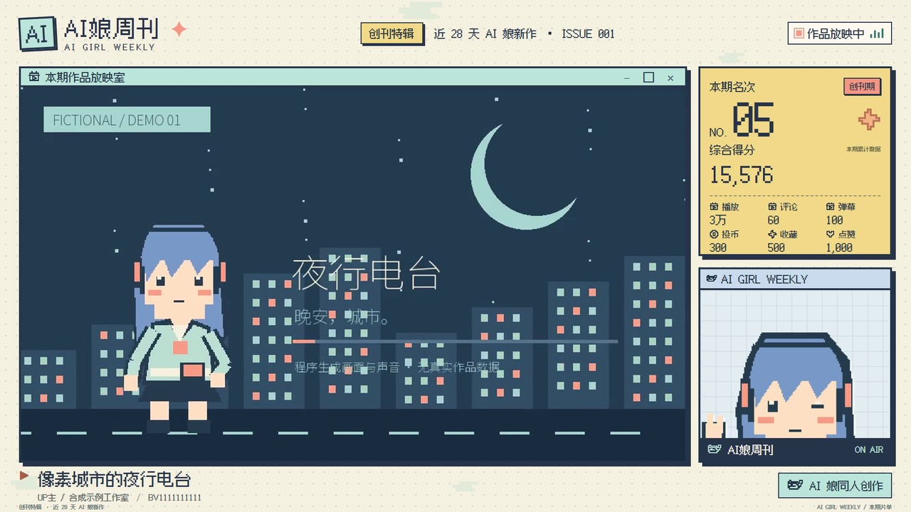
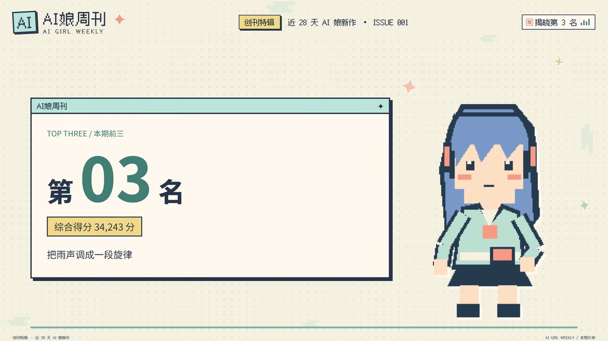
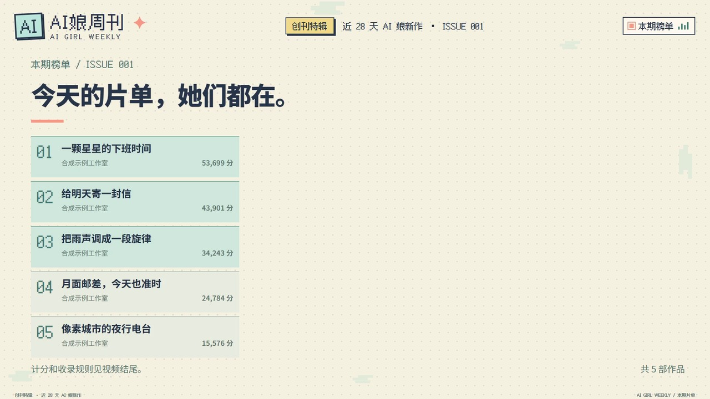
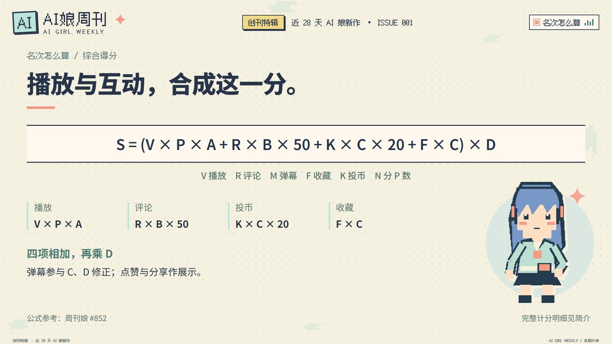
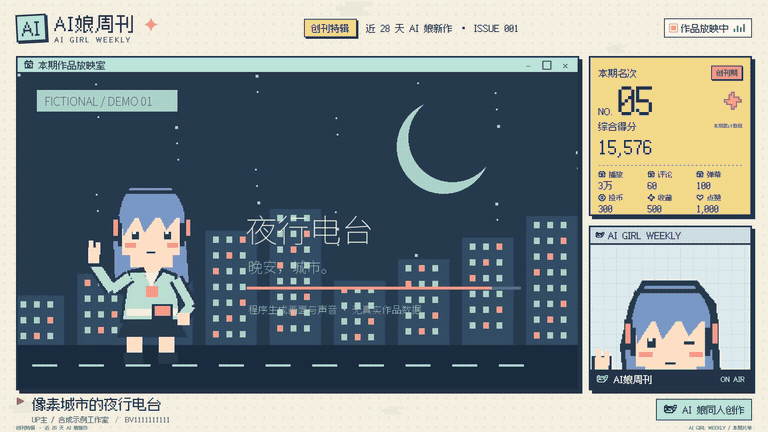

# Weekly Production · 像素风周刊制作

把本期榜单、文案、原视频和 BGM 放在一起，再选一套角色素材，导出一支完整的周刊视频。你可以直接运行 CLI，也可以让支持 Skill 的 AI 助手替你整理材料、选择片段和执行制作。

同一期内容还可以导出像素风文字网页、整期榜单长图、每条作品的 PNG 分享卡，以及 2.35:1 和 1:1 公众号封面。网页与视频使用同一片单、名次、得分和节目时间，不用再整理一份榜单。


[观看完整演示 MP4](https://github.com/lmy414/weekly-production/releases/download/v1.0.0/weekly-production-demo.mp4) · [下载制作 Skill](https://github.com/lmy414/weekly-production/releases/download/v1.1.0/weekly-production-1.1.0.zip) · [下载演示材料](https://github.com/lmy414/weekly-production/releases/download/v1.0.0/weekly-production-demo-inputs-1.0.0.zip)

## 你会得到什么

一支有开场、片单、排名、作品片段、转场、前三名揭晓和片尾的 MP4。像素风边框、角色位置、数据卡、文字版式和声音衔接由模板完成，每期换内容与角色即可继续制作。

当前模板沿用 AI 娘周刊的节目顺序：

```text
4 秒开场 → 7 秒本期片单 → 主榜倒序播放 → 前三名揭晓
→ 榜单回看 → 收录与计分规则 → 片尾与出处署名
```

普通名次在直播间作品窗内播放。前三名先显示作品与数据，再切为连续全屏，保留同一个段落。作品使用原声，开场、转场和说明使用你提供的 BGM；节目通过画面与文字表达，没有额外播报语音。

| 成片项目 | 默认规格 |
| --- | --- |
| 视频 | MP4、1920 × 1080、16:9、30 fps |
| 编码 | H.264，CRF 18 |
| 声音 | AAC、256 kbps、48 kHz、双声道 |
| 片单 | 每期 1 至 15 条作品，按综合得分排序 |
| 时长 | 由作品选段与固定包装共同决定，保留已确认的连续片段 |
| 交付 | 你指定路径的一份成品视频 |

## 实际输出展示

下列图片与动画均取自本项目 CLI 导出的演示视频。演示片长 2 分 39 秒，5 条短片均完整播放。作品、作者、统计数字、角色、画面和配乐全部由程序生成，可以随示例一起下载。

| 作品与排名 | 前三名揭晓 |
| --- | --- |
|  |  |
| 连续播放原片，旁边显示作者、得分与数据。 | 揭晓后进入作品播放，7 秒后切为全屏。 |

| 本期片单 | 片尾计分说明 |
| --- | --- |
|  |  |
| 开场用一页介绍本期内容，之后进入正片。 | 在作品结束后公开口径、公式和排序规则。 |



完整演示保留了所有栏目和原始导出规格。[下载 MP4](https://github.com/lmy414/weekly-production/releases/download/v1.0.0/weekly-production-demo.mp4) 可查看声音、连续选段和完整节奏。

## 准备两个输入包

**每期数据包**放这一期要用的内容：作品清单与指标、节目文案、本地原视频、每条作品的选段、BGM 和来源信息。入口是 `episode.json`。

**角色素材包**放可反复使用的角色图。入口是 `character.json`，至少准备一张透明 PNG。可以另配欢迎、转场、前三名和告别等姿势；没有单独配置的场景会使用默认图。

```text
我的周刊材料/
  第002期/
    episode.json
    videos/          原视频或已选好的连续片段
    audio/           本期 BGM
  像素信使/
    character.json
    images/          透明角色图
```

素材可以放在仓库外，相对路径以各自的 JSON 文件为起点。UI、字体、转场和固定规则已随工具提供。具体字段和文案选项见[输入包说明](INPUT_OUTPUT.md)。

## 先跑一遍演示

准备 Python 3.11 或以上、Node.js 22.12 或以上，以及 Chrome / Chromium。FFmpeg 可使用系统安装版本，Python 依赖也提供了后备版本。运行全程使用无头浏览器，无需一直开着窗口。

下载本仓库，进入项目目录后安装依赖：

```sh
python -m pip install -r requirements.txt
npm ci --prefix skills/weekly-production/scripts --ignore-scripts --no-audit --no-fund
python weekly.py doctor --json
```

如果 `doctor` 提示找不到浏览器，按[浏览器配置](docs/USAGE.md#配置浏览器)设置 `WEEKLY_CHROME`，然后重新检查。

将[演示材料压缩包](https://github.com/lmy414/weekly-production/releases/download/v1.0.0/weekly-production-demo-inputs-1.0.0.zip)解压到项目下的 `demo/`，再运行：

```sh
python weekly.py build --episode demo/episode/episode.json --character demo/character/character.json --output output/demo.mp4 --json
```

成功后打开 `output/demo.mp4`，就是你刚刚制作的完整节目。也可以运行 `python examples/make_demo.py --directory demo`，从代码生成同一套演示材料。生成命令需要一个尚不存在的目录。

## 制作自己的下一期

按演示包替换本期数据、文字、原片和音乐，再切换到自己的角色包。先检查材料，之后直接导出：

```sh
python weekly.py validate --episode "我的周刊材料/第002期/episode.json" --character "我的周刊材料/像素信使/character.json" --json
python weekly.py build --episode "我的周刊材料/第002期/episode.json" --character "我的周刊材料/像素信使/character.json" --output "output/第002期.mp4" --json
```

`validate` 返回 `ok: true` 且 `ready: true` 时，材料已齐。长原片需要在 `clip` 中写明起止时间；不超过 60 秒的短作品可以整条保留。需要 AI 协助时，把两个入口文件交给 Skill，让它先分析本地视频，再保存合适的完整段落。

制作完成后，观看 MP4，检查片单是否遗漏、主题是否合适，以及选段是否完整。修改内容后用同一条命令重新导出，已完成且材料未变的作品片段会复用。

## 让 AI 助手运行

[下载 Skill 压缩包](https://github.com/lmy414/weekly-production/releases/download/v1.1.0/weekly-production-1.1.0.zip)，将其中的 `weekly-production` 文件夹放到助手支持的 Skill 目录。按[独立 Skill 安装说明](docs/USAGE.md#安装独立-skill)安装运行依赖后，可以这样交代任务：

> 使用 weekly-production。读取我提供的 episode.json 和 character.json，检查材料与选段，使用现有文案、配乐和素材，导出指定路径的完整 MP4。需要补选段时，先查看本地视频，保留能独立理解的连续段落。

Skill 可以辅助整理与选段。已有完整输入时，CLI 本身不依赖在线模型，材料读取与渲染在本机完成。

## 网页与分享图

在 `build` 命令中加 `--web-output "output/website"`，成片通过检查后会一起生成图文版。已有 MP4 时，可直接导出，无需重渲染：

```sh
python weekly.py export --episode "本期/episode.json" --character "角色/character.json" --output "成品/第002期.mp4" --directory "output/website" --json
```

你会得到可部署的静态网站：本期榜单、往期档案、计分说明、作品搜索筛选，以及可预览和保存的整期长图与作品卡。重复导出会保留往期页面，同一期更新原页面。分享图保留标题、作者、名次和得分。

导出还会生成两张分别排版的公众号 JPEG 封面：横版 1410 × 600（2.35:1）和方版 1080 × 1080（1:1）。文件位于 `assets/issues/<期号>/cover-wechat-2.35x1.jpg` 与 `cover-wechat-1x1.jpg`，CLI 结果中的 `wechat_covers` 返回完整路径。

**二维码默认关闭。** 要使用，请自己提供网站地址，再加 `--qr --site-url https://weekly.example.com`。默认扫码访问你的网站本期页，作品卡定位到对应作品；需要原作地址或自定义跳转时再配置链接源。网站署名不会自动开启二维码，也不会自动加入追踪参数。

完整配置、公开介绍和本地预览方法见[图文导出说明](skills/weekly-production/references/web.md)。`v1.2.0` Skill 在图文导出的基础上增加公众号双尺寸封面；此前的 `v1.0.0` Release 保留原视频版本。

## 计分与使用范围

工具根据输入指标计算综合得分，公式、舍入方式与同分顺序见[计分与排名规则](RANKING.md)，也会在片尾展示。累计特辑使用累计指标；常规周榜把每项指标的周期净增量代入公式。点赞与分享单独展示。

榜单数据和原视频由你准备。本项目提供制作 Skill、CLI、模板与合成示例，采集、登录、下载和投稿由外部工具完成。真实输入包与成片留在你的私有目录。

当前版本已在 Windows 上完成无头整期制作验证。其他系统的浏览器依赖与路径配置见[使用说明](docs/USAGE.md)；尚未完成 Linux / macOS 的整期验证。

## 许可与致谢

代码、模板和本仓库合成示例采用 [GPL-3.0-only](LICENSE)。内置 Fusion Pixel 和 Noto Sans SC 字体保留各自许可，来源见[第三方资源说明](THIRD_PARTY_NOTICES.md)。你放入的角色图、音乐、视频和节目内容仍适用各自的授权。

计分方案参考周刊哔哩哔哩排行榜的公开说明，出处与本项目细则列在[排名规则](RANKING.md)中。
